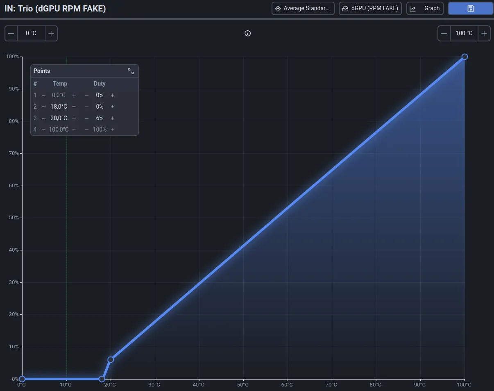

# Linux Hardware Passthrough

**📝 Text: [🇺🇸 EN](https://nzsh.cc/blog/en/windows-but-on-linux-hardware-passthrough/) | [RU 🇷🇺](https://nzsh.cc/blog/windows-but-on-linux-hardware-passthrough/)**

---

### Script: NVIDIA Temperature Guest → Host Passthrough

- `/dev/shm/gpu-temp` - Temperature
- `/dev/shm/gpu-rpm-lock` - Fans (true/false, not speed)
  - 10 - stop
  - 20 - work

  <figure>
    
    <figcaption>Example of use <code>gpu-rpm-lock</code> in a fan curve.</figcaption>
  </figure>

